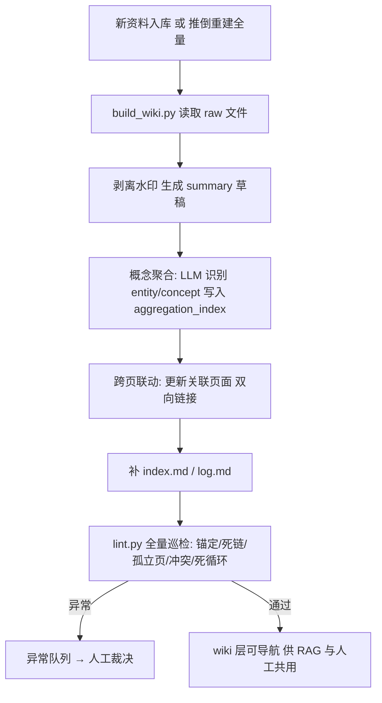

# LLM Wiki — raw → wiki → RAG 双轨知识编译层

> 一套真实运行过的 **LLM 知识库编译工具链**：把 1,600+ 篇原始资料自动编译为可导航的 wiki 知识层（实体 / 概念 / 对比 / 综合四类页面），实现**同一概念多源聚合、页面间双向链接、增量局部重编、lint 全库巡检**。
>
> 本文档是通用化、脱敏后的方法论版本。原体系在某连锁零售品牌知识库真实运行：1,641 篇原始资料 → 1,317 页 wiki 知识层，lint 锚定通过率 **100%**、死链 / 孤立页 / 冲突 / 死循环全 0。

> 📌 **技术关键词**：RAG 知识库 / 概念聚合 / 双向链接 / 增量编译 / Schema 契约 / lint 巡检 —— 覆盖企业知识库工程化的完整落地路径。

## 为什么做这个

RAG 直接喂原始文档有两个真实问题：

1. **原始资料保真但不可导航**：1,600 篇散落的 markdown，人工检索靠文件名猜，RAG 召回靠关键词碰运气，同一主题分散在几十篇里。
2. **泛词塌缩**：垂直领域的高频词（如「会员」「复购」「短保」）被大量文档引用，关键词检索被泛词淹没，精确信息反而排不上来。

解决方案不是只换检索算法，而是加一层**编译层**：把原始资料离线编译成可导航的 wiki 知识层，人工检索与 RAG **共用同一编译产物**——这就是 raw → wiki → RAG 双轨架构。

## 仓库结构

```
llm-wiki/
├── README.md                    # 总览（本文件）
└── docs/
    ├── 01-architecture.md      # raw → wiki → RAG 双轨架构
    ├── 02-schema.md            # wiki_schema.md 编译契约（五类页面模板）
    ├── 03-aggregation.md       # 概念聚合：多源合并一页
    ├── 04-incremental.md       # 增量局部重编：--local-rebuild 反向闭包
    ├── 05-lint.md              # lint 巡检：锚定/死链/孤立页/冲突/死循环
    └── 06-results.md           # 真实运行结果与验收口径
```

## 核心概念速览

| 概念 | 一句话 |
|---|---|
| **raw 层** | 原始资料只读不可变，保真兜底（1,641 篇） |
| **wiki 层** | 编译产物可导航：entity 实体 / concept 概念 / comparison 对比 / synthesis 综合 |
| **Schema 契约** | `wiki_schema.md` 每次编译注入 LLM 提示词，保证行为一致 |
| **概念聚合** | 同一实体/概念多源 → 合并一页，来源列表逐条列源（聚合页 80+ 源） |
| **双向链接** | entity ↔ concept ↔ synthesis 层级互链，comparison 挂接两端实体 |
| **增量重编** | `--local-rebuild <page>` 按双向链接反向闭包只重编受影响页，实测仅 4 页 |
| **lint 巡检** | 锚定 / 死链 / 孤立页 / 冲突 / 死循环五类检查，锚定通过率 100% |

## 编译链路



## 命令行

```bash
# 全量编译（按子库批次）
python build_wiki.py --batch 行业趋势

# 增量续跑（跳过已生成页面）
python build_wiki.py --skip-existing

# 增量局部重编（只重编受影响页，不触发全量）
python build_wiki.py --local-rebuild entity/金粒门.md

# 大文件分段（>100KB 自动分段）
python build_wiki.py --batch 产品研发 --chunk 50000

# 全库巡检
python lint.py
```

## 适用场景

- 正在搭建企业知识库 / RAG 检索体系的人
- 原始资料上千篇、检索被泛词淹没、需要可导航知识层的人
- 想了解「同一概念多源合并一页」与「增量局部重编」如何落地的人
- 做 AI 落地交付的工程师 / 顾问（AI Solutions / 企业 AI 落地）

## License

MIT