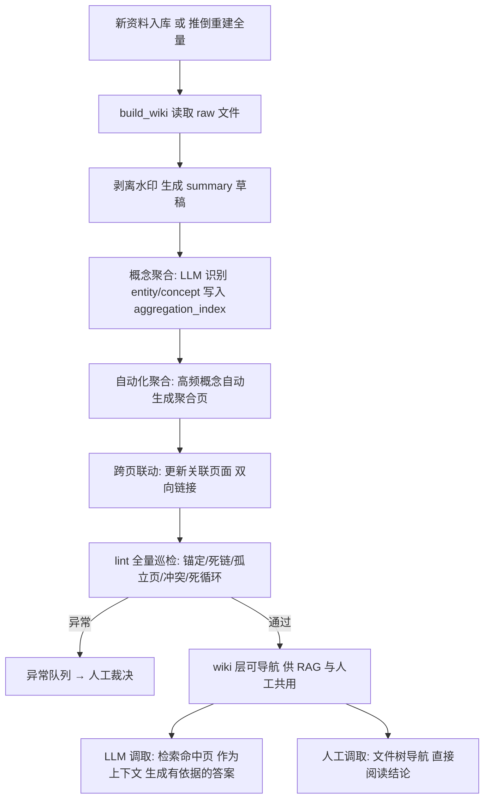

# LLM Wiki — LLM × RAG 知识库调取系统（raw → wiki → RAG 双轨）

> 一套真实运行过的 **LLM 参与组织、供 LLM 调取的 RAG 知识库体系**：把 1,600+ 篇原始资料自动编译为可导航的 wiki 知识层（实体 / 概念 / 对比 / 综合四类页面），实现**同一概念多源聚合、页面间双向链接、增量局部重编、lint 全库巡检**——编译产物既是人工检索的知识地图，也是 LLM 问答 / 内容生成的**上下文调取层**。
>
> **说明**：本仓库公开的是**通用化、脱敏后的方法论**（架构思路 + 编译契约 + 聚合/增量/lint 设计）。原体系在某连锁零售品牌知识库真实运行（1,641 篇 → 1,317 页，lint 锚定 100%），但**生产实现深度绑定品牌私有知识库与内部模型服务，属于品牌独特自研改造，不对外提供可运行源码**。

> 📌 **技术关键词**：RAG 知识库 / 概念聚合 / 双向链接 / 增量编译 / Schema 契约 / lint 巡检 —— 覆盖企业知识库工程化的完整落地路径。

## 为什么做这个

RAG 直接喂原始文档有两个真实问题：

1. **原始资料保真但不可导航**：1,600 篇散落的 markdown，人工检索靠文件名猜，RAG 召回靠关键词碰运气，同一主题分散在几十篇里。
2. **泛词塌缩**：垂直领域的高频词（如「会员」「复购」「短保」）被大量文档引用，关键词检索被泛词淹没，精确信息反而排不上来。

解决方案不是只换检索算法，而是**让 LLM 参与知识组织**：把原始资料离线编译成可导航的 wiki 知识层，人工检索与 LLM 调取 **共用同一编译产物**——这就是 raw → wiki → RAG 双轨架构。它本质是 **LLM × RAG 结合的知识库调取系统**：LLM 负责「把散资料编译成结构化知识」，RAG 负责「从结构化知识里精确召回」，两者结合后，知识库既能被人工导航，也能被 LLM 作为上下文调取，生成有依据的答案。

## 仓库结构

```
llm-wiki/
├── README.md                    # 总览（本文件）
└── docs/
    ├── 01-architecture.md      # raw → wiki → RAG 双轨架构
    ├── 02-schema.md             # wiki_schema.md 编译契约（五类页面模板）
    ├── 03-aggregation.md         # 概念聚合：多源合并一页（自动化聚合）
    ├── 04-incremental.md        # 增量局部重编：--local-rebuild 反向闭包
    ├── 05-lint.md               # lint 巡检：锚定/死链/孤立页/冲突/死循环
    ├── 06-results.md            # 真实运行结果与验收口径
    └── 07-retrieval-ranking.md  # RAG 检索排序演进 v2.1→v2.4（词频饱和/业务子库加权）
```

## 核心概念速览

| 概念 | 一句话 |
|---|---|
| **raw 层** | 原始资料只读不可变，保真兜底（1,641 篇） |
| **wiki 层** | 编译产物可导航：entity 实体 / concept 概念 / comparison 对比 / synthesis 综合 |
| **Schema 契约** | `wiki_schema.md` 每次编译注入 LLM 提示词，保证行为一致 |
| **概念聚合** | 同一实体/概念多源 → 合并一页，来源列表逐条列源（聚合页 80+ 源） |
| **双向链接** | entity ↔ concept ↔ synthesis 层级互链，comparison 挂接两端实体 |
| **增量重编** | `--local-rebuild <page>` 按双向链接反向闭包只重编受影响页，实测仅 4 页 |
| **lint 巡检** | 锚定 / 死链 / 孤立页 / 冲突 / 死循环五类检查，锚定通过率 100% |
| **LLM 调取** | 编译产物作为上下文供 LLM 问答/内容生成调取，人工与 LLM 共用同一知识层 |
| **RAG 排序** | v2.4 排序器：倒排索引 + 2-gram 候选定位 + 词频饱和 + 业务子库加权 |

## 方法论核心



> 命令行示例（`--batch` / `--local-rebuild` 等）为方法论示意，生产实现依赖品牌私有知识库与内部模型服务，不提供可运行源码。

## 适用场景

- 正在搭建企业知识库 / RAG 检索体系的人
- 原始资料上千篇、检索被泛词淹没、需要可导航知识层的人
- 想了解「同一概念多源合并一页」与「增量局部重编」如何落地的人
- 做 AI 落地交付的工程师 / 顾问（AI Solutions / 企业 AI 落地）

## 围绕同一场景改造出的配套产出

> **核心**：围绕「45+ 家门店 AI 落地」场景，按真实故障逐步改造成 5 个公开项目 + 2 个桌面软件。每个产出解决一个具体故障。

```
接入 AI（gateway）→ 用好 AI（prompt-craft）→ LLM×RAG 知识库（本仓库）→ 组织 AI 落地（ai-native-team）→ 交付业务结果（驾驶舱 / 指挥台）
```

### 本仓库在场景中的位置

**为什么改造**：早期 kb-cli 解决了「原始资料找得到」，但 1,600+ 篇原始资料**不可导航**——人工靠文件名猜、RAG 泛词塌缩、同一主题散落几十篇。不改，知识库越大越难用。

**意义**：作为 **LLM × RAG 结合的知识库调取系统**替代早期 kb-cli——raw → wiki → RAG 双轨：原始资料保真不可变，编译产物可导航聚合（实体/概念/对比/综合四类页），人工与 LLM 共用同一产物。LLM 负责知识组织与答案生成，RAG 负责精确召回，精确召回大幅提升。

**结合哪些部分**：
- 编译过程跑在 **sensenova-gateway** 的稳定模型通道上
- 自动化聚合由 **ai-native-team** 的知识库每日维护任务驱动
- 编译产物被 **驾驶舱** 的 AI 结论卡引用

**单独用的价值**：即使不接入其他产出，任何「原始资料上千篇、检索被泛词淹没」的团队都能直接复用这套 RAG 方法论——概念聚合 + 增量局部重编 + lint 质量门，把原始文档变成可导航知识层。

### 相关项目

- **[sensenova-gateway](https://github.com/Babymrbbbb/sensenova-gateway)** — 接入 AI：批量编译的模型稳定性保障
- **[prompt-craft](https://github.com/Babymrbbbb/prompt-craft)** — 用好 AI：编译提示词与 Schema 契约同源
- **[kb-cli](https://github.com/Babymrbbbb/kb-cli)** — 早期实现：分层 + 召回优先思路的验证原型
- **[ai-native-team](https://github.com/Babymrbbbb/ai-native-team)** — 组织 AI 落地：知识库每日维护自动化

## License

本文档为方法论公开，采用 MIT 授权；生产实现（含自动化聚合脚本、品牌实体词表、RAG 调整）为品牌独特自研改造，不对外开源。